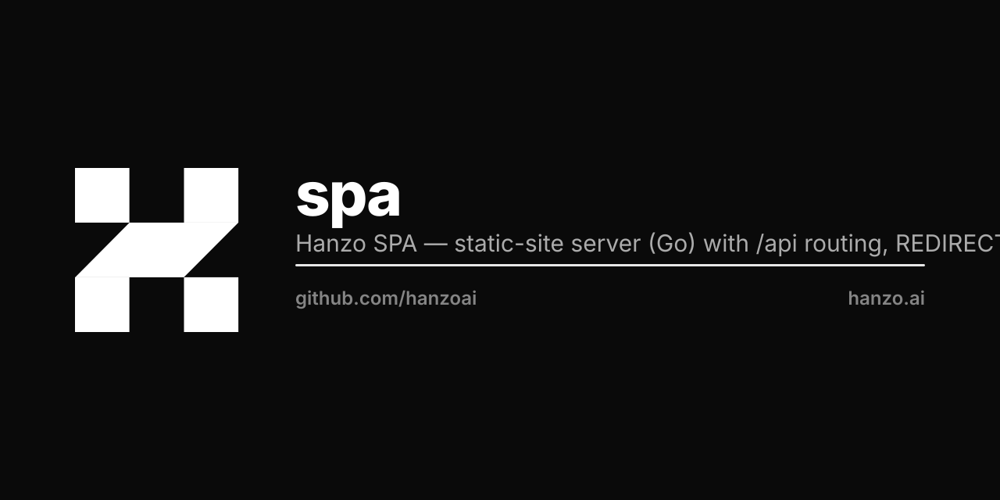

<p align="center"></p>

# hanzoai/spa

Zero-config SPA server. Drop your build output and run.

```dockerfile
FROM ghcr.io/hanzoai/spa
COPY dist /public
```

That's it. No flags, no config files, no Node.js.

## What it does

- **SPA mode always on** — `index.html` served for all routes
- **Smart caching** — hashed assets (Vite `index-DByAis3x.js`) get 1 year immutable, `index.html` + `config.json` get no-cache
- **Pre-compressed** — serves `.br` and `.gz` files automatically
- **Security headers** — HSTS, X-Content-Type-Options, Referrer-Policy, Permissions-Policy
- **Health check** — `GET /health` → `{"status":"ok"}`
- **Runtime config** — templates `/public/config.json` from `SPA_*` env vars at startup
- **Scratch-based** — ~5MB image, zero attack surface

## Environment

| Var | Default | Description |
|-----|---------|-------------|
| `PORT` | `3000` | Listen port |
| `ROOT` | `/public` | Static files directory |
| `MULTI_APP` | `false` | Hostname-prefix routing to `/public/<app>/` |
| `DEFAULT_APP` | `default` | Fallback app in multi-app mode |
| `ALLOW_FRAMING` | `false` | Drop X-Frame-Options + frame-ancestors |
| `SPA_PROTECT` | — | `iam` locks the whole site behind Hanzo IAM OIDC (see below) |
| `SPA_*` | — | Templated into `/public/config.json` (see below) |

## Protect mode

Set `SPA_PROTECT=iam` and the entire site is locked behind Hanzo IAM
(hanzo.id) OIDC — one env var, any static site. Anonymous visitors see only a
minimal white sign-in gate; no real markup or asset byte is served until an
allow-listed admin signs in via Authorization-Code + PKCE. Fail-closed
everywhere. Unset = no gate (byte-for-byte the default behavior).

| Var | Default | Description |
|-----|---------|-------------|
| `SPA_PROTECT` | — | `iam` enables the gate; empty/unset disables it |
| `SPA_PROTECT_ALLOW` | — | Comma list of allowed emails, case-insensitive. **Required** when enabled — empty gates everyone |
| `SPA_IAM_HOST` | `https://hanzo.id` | OIDC issuer (reuses the existing var) |
| `SPA_PROTECT_CLIENT_ID` | — | Confidential OIDC client id |
| `SPA_PROTECT_CLIENT_SECRET` | — | Client secret — env only, inject from a k8s Secret |
| `SPA_PROTECT_REDIRECT` | derived | OIDC callback; default `https://<Host>/auth/callback` |
| `SPA_PROTECT_COOKIE_SECRET` | random | HMAC key for the session cookie. Set it (from a Secret) in prod so sessions survive restarts |
| `SPA_PROTECT_BRAND` | `Protected` | Optional wordmark on the gate |

Reserved routes when enabled: `/health` (never gated), `/auth/login`,
`/auth/callback`, `/auth/logout`. OIDC endpoints are discovered from
`${SPA_IAM_HOST}/.well-known/openid-configuration` at startup. Identity is read
from the userinfo endpoint (hanzo.id may sign id_tokens with post-quantum
MLDSA65, which is not locally verifiable) over the access token.

## Runtime config

The SPA reads `/config.json` on boot and derives its API/IAM/RPC hosts from it. One bundle runs on any environment; only the pod env changes.

```yaml
env:
- name: SPA_ENV
  value: test
- name: SPA_API_HOST
  value: https://api.test.example.com
- name: SPA_IAM_HOST
  value: https://iam.test.example.com
- name: SPA_RPC_HOST
  value: https://rpc.test.example.com
- name: SPA_ID_HOST
  value: https://id.test.example.com
- name: SPA_CHAIN_ID
  value: "1"
```

Writes at startup:

```json
{"apiHost":"https://api.test.example.com","chainId":1,"env":"test","iamHost":"https://iam.test.example.com","idHost":"https://id.test.example.com","rpcHost":"https://rpc.test.example.com","v":1}
```

Rules:
- `SPA_FOO_BAR` → `fooBar` (camelCase).
- All-digit values → JSON numbers.
- `true` / `false` → JSON booleans.
- Other values → JSON strings.
- `v: 1` is always set — schema version.
- No `SPA_*` vars set → the placeholder `/public/config.json` shipped with the image is left untouched (SPA falls back to its own defaults).

In `MULTI_APP=true` mode, each `/public/<app>/config.json` gets the same content. Per-app env overrides aren't needed because multi-app routing is hostname-based and SPAs detect env from hostname as a fallback anyway.

## Usage

```bash
# Local
go run .

# Docker
docker build -t spa .
docker run -v ./dist:/public -p 3000:3000 spa

# Production (multi-stage)
FROM node:22-alpine AS build
WORKDIR /app
COPY . .
RUN pnpm install && pnpm build

FROM ghcr.io/hanzoai/spa
COPY --from=build /app/dist /public
```

Ship a placeholder `/public/config.json` in your build output for local dev; the SPA server replaces it at pod startup.

## Tests

```bash
go test -v ./...
```
